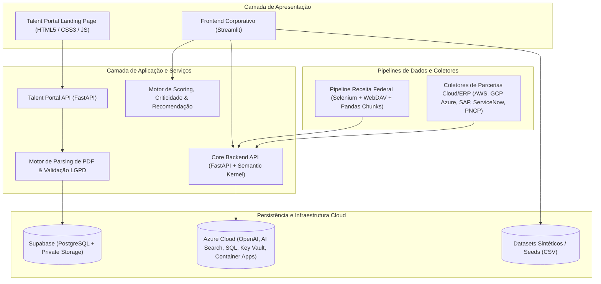

# Enterprise Vendor Hub

**Enterprise Vendor Hub** é uma plataforma corporativa de inteligência de fornecedores, recomendação assistida por IA, gestão de *body shop* (alocação de talentos terceirizados) e enriquecimento automatizado de dados cadastrais e técnicos.

O sistema centraliza o ciclo de vida de *sourcing* tecnológico — desde a descoberta e homologação de fornecedores até a ingestão estruturada de currículos com conformidade LGPD e análise de indicadores de performance (KPIs).

---

## 🎯 O Problema de Engenharia

Em grandes operações corporativas de tecnologia e suprimentos (*procurement*), a seleção e gestão de parceiros técnicos enfrenta quatro gargalos críticos:

1. **Fragmentação e Assimetria de Dados:** Informações sobre fornecedores (certificações em nuvem, histórico de entregas, SLAs, faixas de gasto anual e status de homologação) costumam ficar dispersas em planilhas isoladas, ERPs legados e documentos não estruturados.
2. **Alto Tempo de *Sourcing* e Mobilização:** Encontrar fornecedores homologados com competências específicas (ex.: *SAP S/4HANA*, *FinOps*, *Observabilidade*, *Cybersecurity*) ou alocar especialistas em regime de *body shop* demanda triagem manual demorada.
3. **Desatualização Cadastral e Descoberta de *Lookalikes*:** Identificar empresas semelhantes no mercado brasileiro a partir de uma lista de parceiros de referência exige processar dezenas de gigabytes de dados abertos da Receita Federal (bases de Estabelecimentos e CNAEs), o que inviabiliza consultas em memória convencional.
4. **Conformidade Legal (LGPD) na Captação de Talentos:** A recepção de currículos para bancos de talentos técnicos requer validação estrita de arquivos PDF, extração automatizada de *skills*/senioridade, deduplicação por CPF/e-mail e rastreabilidade completa de consentimento e tempo de retenção.

### Como o Enterprise Vendor Hub resolve isso:
- **Motor de Recomendação Ponderado & Assistente Conversacional:** Avalia fornecedores combinando cobertura semântica/técnica ($32{,}5\%$), histórico de avaliações ($27{,}5\%$), disponibilidade operacional ($22{,}5\%$) e competitividade de custos ($17{,}5\%$), atribuindo faixas de confiança (*Alta*, *Média*, *Baixa*) e alertas de risco.
- **Pipeline de *Big Data* para Descoberta por CNAE/CNPJ:** Automatiza a extração via WebDAV da Receita Federal com suporte a retomada de downloads parciais (`HTTP Range` / `206 Partial Content`), *backoff* exponencial e processamento em *chunks* (`500.000` registros por lote) para baixo consumo de RAM.
- **Portal de Talentos com Ingestão Transacional:** API em FastAPI integrada ao Supabase (PostgreSQL + Storage privado) que valida a assinatura binária de currículos PDF (`%PDF-`), extrai seções de competências e senioridade via *parsing* textual, registra metadados de consentimento LGPD e executa *rollback* compensatório automático em caso de falha parcial no upload.
- **Fila de Enriquecimento por IA & Monitoramento de KPIs:** Interface executiva e operacional em Streamlit para validação humana (*human-in-the-loop*) de dados enriquecidos por coletores externos e acompanhamento de metas de *sourcing*, *Hit-Rate@5*, CSAT e cobertura de avaliação (IDF).

---

## 🏗️ Arquitetura do Sistema

O projeto é organizado em uma arquitetura modular dividida em cinco domínios principais:



### Estrutura de Diretórios

```text
enterprise-smart-vendor-hub/
├── backend/                  # API principal, orquestrador de agentes IA e regras de negócio
│   ├── app/
│   │   ├── agents/           # Orquestração com Semantic Kernel e plugins
│   │   ├── api/              # Rotas FastAPI (busca, fornecedores, body_shop, kpis)
│   │   ├── enrichment/       # Regras de criticidade e validação de enriquecimento
│   │   └── main.py           # Entrypoint da API principal
│   ├── Dockerfile
│   └── pyproject.toml
├── collectors/               # Coletores de dados públicos e diretórios de parceiros
│   ├── common/               # Utilitários de rate-limit e verificação de robots.txt
│   ├── partners/             # Conectores (AWS, GCP, Microsoft, SAP, ServiceNow)
│   ├── pncp/                 # Coletor do Portal Nacional de Contratações Públicas
│   └── receita_federal/      # Integração com dados abertos de CNPJ
├── data/                     # Scripts de processamento massivo e seeds de dados
│   ├── buscar_empresas.py    # Pipeline automatizado WebDAV + chunking de CNPJ/CNAE
│   └── requirements.txt
├── frontend/                 # Plataforma interativa em Streamlit
│   ├── components/           # Componentes visuais reutilizáveis (badges padronizados)
│   ├── dados_csv/            # Base de dados fictícios (mock data) para demonstração
│   ├── pages/                # Módulos: Home, Chat IA, Fornecedores, Body Shop, KPIs, Ranking, Fila IA, Login
│   └── app.py                # Roteador de navegação e controle de acesso (RBAC)
├── infra/                    # Infraestrutura como Código (Azure Bicep)
│   ├── environments/         # Parâmetros de deploy (dev, prod)
│   ├── modules/              # Módulos (OpenAI, AI Search, Container Apps, SQL, Key Vault, Entra RBAC)
│   └── main.bicep
├── talent_portal/            # Microsserviço de captação de talentos e ingestão de currículos
│   ├── consent/              # Geração e validação de metadados LGPD e retenção
│   ├── db/                   # Cliente Supabase configurado via variáveis de ambiente
│   ├── ingestion/            # Rotas, parser de PDF (pypdf) e serviço com rollback transacional
│   ├── landing/              # Interface web responsiva para submissão de candidaturas
│   └── main.py               # Entrypoint FastAPI do Talent Portal
├── .env.example              # Template de variáveis de ambiente
├── .gitignore                # Regras de bloqueio para segredos, bancos locais e planilhas reais
├── docker-compose.yml        # Orquestração local de containers
└── Makefile                  # Automação de tarefas de desenvolvimento
```

---

## 🛠️ Stack Tecnológica

| Camada | Tecnologias Utilizadas |
| :--- | :--- |
| **Linguagens** | Python 3.11+, JavaScript (ES6+), HTML5, CSS3, Bicep (IaC) |
| **Frontend & Dashboards** | Streamlit, `streamlit-chat`, Pandas |
| **Backend & APIs** | FastAPI, Uvicorn, Python-Multipart, Pydantic |
| **Banco de Dados & Storage** | Supabase (PostgreSQL + Object Storage), Azure SQL |
| **Processamento de Documentos & Dados** | `pypdf` (extração de PDFs em memória), Pandas (leitura vetorizada em *chunks*), ElementTree (XML/WebDAV) |
| **Automação & Web Scraping** | Selenium WebDriver, Requests (streaming com suporte a `HTTP Range` e *retry backoff*) |
| **Inteligência Artificial & Busca** | Azure OpenAI, Azure AI Search, Semantic Kernel |
| **Infraestrutura & DevOps** | Docker, Docker Compose, Azure Container Apps, Azure Key Vault, Microsoft Entra ID (RBAC) |

---

## ⚙️ Configuração e Execução Local

### 1. Pré-requisitos
- **Python 3.11+**
- **Git**
- **Google Chrome** (opcional, apenas para descoberta dinâmica de token no pipeline da Receita Federal caso `RECEITA_SHARE_TOKEN` não seja informado)
- Conta/projeto no **Supabase** (para execução da API do *Talent Portal*)

### 2. Variáveis de Ambiente

Copie o arquivo de exemplo [`.env.example`](file:///c:/Users/migue/enterprise-smart-vendor-hub/.env.example) para `.env` na raiz do projeto e preencha as credenciais do seu ambiente:

```bash
cp .env.example .env
```

Principais variáveis configuráveis:
- `SUPABASE_URL` e `SUPABASE_KEY`: Credenciais de conexão com o projeto Supabase.
- `CORS_ORIGINS`: Origens permitidas na API do Portal de Talentos (padrão: `http://localhost:5500,http://127.0.0.1:5500`).
- `CANDIDATE_RETENTION_DAYS`: Prazo de retenção de dados pessoais sob a LGPD (padrão: `365`).
- `MOCK_DATA_DIR`: Diretório de arquivos CSV fictícios consumidos pelo frontend (padrão: `dados_csv`).
- `DADOS_GOV_CNPJ_URL`, `RECEITA_WEBDAV_BASE_URL`, `RECEITA_SHARE_TOKEN`: Configurações do pipeline de dados abertos da Receita Federal.

---

### 3. Executando o Frontend (Plataforma de Inteligência & Dashboards)

O frontend em Streamlit já conta com dados sintéticos (*mock data*) em `frontend/dados_csv/` e pode ser executado imediatamente:

```bash
cd frontend
pip install -r requirements.txt
streamlit run app.py
```

A aplicação estará disponível em `http://localhost:8501`, contendo:
- **Página Inicial:** Visão geral dos módulos da plataforma.
- **Assistente de IA (`1_chat.py`):** Busca conversacional com cálculo de aderência e nível de confiança.
- **Base de Fornecedores (`2_fornecedores.py`):** Filtros multicritério (competência, porte, homologação) e visão detalhada de evidências e histórico.
- **Body Shop (`3_body_shop.py`) & Ranking (`5_ranking.py`):** Acompanhamento de especialistas terceirizados e *score* técnico.
- **KPIs da Plataforma (`4_kpis.py`):** Painel executivo com variação mensal, metas e gráficos de evolução.
- **Fila de Enriquecimento de IA (`6_fila_ai.py`):** Auditoria de atualizações cadastrais sugeridas automaticamente.

---

### 4. Executando o Talent Portal (Backend FastAPI + Landing Page)

Para iniciar a API de ingestão de currículos:

```bash
cd talent_portal
pip install -r requirements.txt
uvicorn main:app --reload --port 8000
```

Para servir a *Landing Page* estática localmente na porta `5500`:

```bash
cd talent_portal/landing
python -m http.server 5500
```

Acesse `http://localhost:5500` no navegador para testar o formulário de candidatura ou consulte a documentação interativa da API (Swagger UI) em `http://localhost:8000/docs`.

---

### 5. Executando o Pipeline de Descoberta de Empresas por CNPJ/CNAE

Para rodar o coletor que identifica empresas semelhantes na base nacional da Receita Federal:

```bash
cd data
pip install -r requirements.txt
python buscar_empresas.py
```

---

## 🔒 Segurança, Privacidade e Boas Práticas de Portfólio

- **Zero Segredos no Código:** Todas as chaves de API, URLs de banco de dados e parâmetros de ambiente são carregados via `os.getenv` / `process.env`.
- **Proteção contra Vazamento de Dados:** O arquivo [`.gitignore`](file:///c:/Users/migue/enterprise-smart-vendor-hub/.gitignore) bloqueia arquivos `.env`, certificados (`.pem`, `.key`), bancos locais (`.db`, `.sqlite3`), dumps brutos (`cnpj_dados/`, `data/raw/`, `data/real/`) e planilhas externas (`.csv`, `.xlsx`), mantendo versionados apenas os *seeds* sintéticos de demonstração.
- **Dados 100% Fictícios:** Todos os CNPJs, nomes de empresas, e-mails (`@example.com` conforme RFC 2606) e históricos presentes em `frontend/dados_csv/` são gerados exclusivamente para fins de demonstração técnica.
